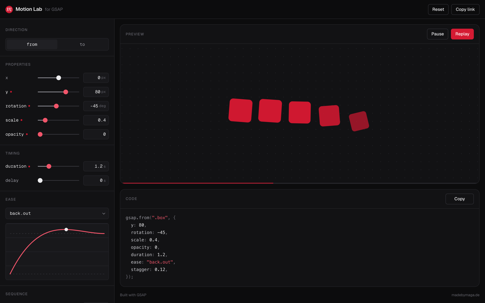

# Motion Lab

A small visual playground for [GSAP](https://gsap.com) tweens.
Tune an animation with sliders, watch it play live, copy the code into your project.



<!-- Live demo: add the deployed URL here -->

## Features

- **Live preview.** Five boxes in a row, so stagger is visible. Every change replays the animation automatically; Play/Pause and Replay are there too (or press `R`).
- **All the basics.** `from` / `to`, `x`, `y`, `rotation`, `scale`, `opacity`, `duration`, `delay`, `stagger`, `repeat` (`-1` = forever) and `yoyo`. Each value has a slider and a number field.
- **Ease picker with curve.** Every common GSAP ease (`none`, `power1`–`power4`, `back`, `elastic`, `bounce`, `expo`, `circ`, `sine`, each as `in` / `out` / `inOut`). The curve is drawn from GSAP's own ease function, overshoot included, and a dot follows the curve while the preview plays.
- **Clean code output.** Only values that differ from GSAP's defaults are written, so the code is exactly as long as it needs to be. One click copies it.
- **Shareable links.** All settings live in the URL with readable keys (`?direction=from&y=60&ease=power3.out`). Copy the link and the exact animation opens for anyone. Invalid values in a hand-edited link are ignored.
- **Reset** returns to the starting animation. Double-click a single label to reset just that value.
- Responsive (panel on top on small screens), keyboard friendly, respects `prefers-reduced-motion` on load.

## Run it locally

Requires Node.js 18 or newer.

```bash
git clone https://github.com/magadnv/gsap-motion-lab.git
cd gsap-motion-lab
npm install
npm run dev        # http://localhost:5880
```

```bash
npm run build      # production build into dist/
npm run preview    # serve the build locally
```

## How it works

One flat state object is the single source of truth. Controls write to it; everything else re-renders from it.

```
controls ──setState──▶ state ──subscribe──▶ controls (sync inputs)
                                       ├──▶ code panel
                                       ├──▶ URL
                                       └──▶ preview
```

The preview and the code panel are built from the **same** vars object (`buildTweenVars` in `codegen.js`), so what you see is exactly what you copy.

```
src/
├─ main.js        wires the modules together
├─ config.js      ranges, defaults, ease list (change numbers here)
├─ state.js       tiny observable store
├─ controls.js    builds the panel from config.js
├─ preview.js     the five boxes and the live tween
├─ easeCurve.js   SVG curve from gsap.parseEase()
├─ codegen.js     state -> tween vars -> code (plain + highlighted)
├─ urlState.js    state <-> query string
├─ clipboard.js   copy with "Copied!" feedback
└─ styles/        tokens.css (all colors as CSS variables), base, layout, controls
```

Adding a new property (say `skewX`) is one line in `PROPERTIES` in `config.js`: the slider, the code output and the URL support follow from it.

## Tech stack

- [Vite](https://vite.dev)
- Vanilla JavaScript (ES modules), no framework
- [GSAP 3](https://gsap.com)
- Plain CSS with custom properties
- Fonts: Geist and Geist Mono

No backend, no tracking, no login.

## Roadmap

**V2**

- **Timeline:** chain several steps into one `gsap.timeline()` with position parameters
- **ScrollTrigger:** preview a scroll-driven version and export the matching code
- **Your own elements:** paste HTML/CSS or pick shapes instead of the five boxes

Ideas after that: stagger options (`from: "center"`, `grid`), `transformOrigin`, a compact preview that stays in view on phones.

## License

[MIT](LICENSE)
